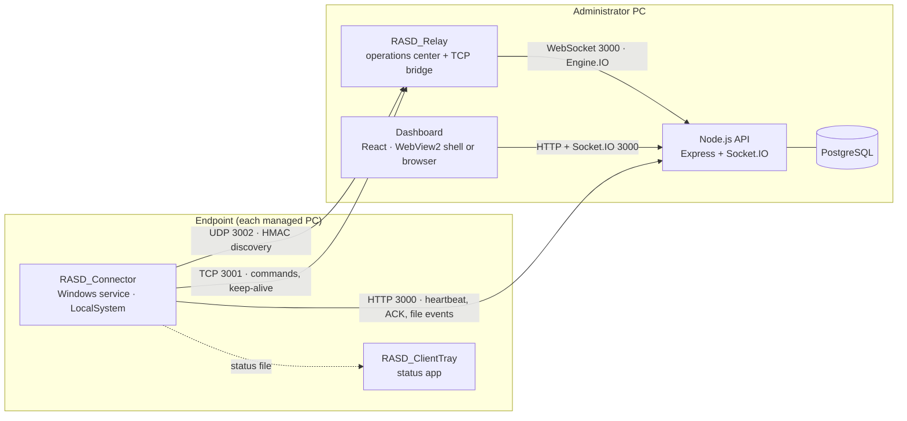

<p align="center">
  
</p>

<h1 align="center">RASD</h1>

<p align="center">
  <strong>Remote Administration Security Dashboard</strong><br />
  Wired-LAN endpoint management and real-time fleet operations for Windows
</p>

<p align="center">
  
  
  
  
  
  
</p>

<p align="center">
  <a href="../../releases/latest"><strong>Download the installer</strong></a> ·
  <a href="#architecture">Architecture</a> ·
  <a href="#installation">Installation</a> ·
  <a href="#building-from-source">Build from source</a> ·
  <a href="#security-considerations">Security</a>
</p>

---

## Overview

RASD lets an IT administrator enroll Windows machines on their own wired LAN, monitor them, and manage them
from a single web dashboard. A lightweight agent runs as a Windows service on each endpoint, discovers the
administrator machine through an authenticated LAN handshake, and executes administrative commands that are
queued, delivered and acknowledged with a full audit trail.

RASD is a graduation project built for **lab and classroom networks the operator owns or administers**. It runs
entirely in user mode (no kernel drivers) and refuses to carry control traffic over Wi-Fi, VPN or virtual
adapters.

## Features

| Area | What RASD does |
|---|---|
| **Device inventory** | Hostname, IP and MAC address, OS version, agent version, USB policy, online state and last-seen time for every enrolled endpoint |
| **Authenticated discovery** | Agents find the admin over UDP with an HMAC-SHA256 signed, nonce-checked handshake; spoofed or replayed replies are rejected and logged |
| **Wired-LAN enforcement** | Agent and relay bind only to physical Ethernet adapters; Wi-Fi, VPN and virtual adapters are refused on both sides |
| **Remote administration** | Restart, shutdown and Windows Update (via PSWindowsUpdate) on demand, per endpoint or fleet-wide |
| **USB storage policy** | Block or allow USB mass storage through four layers: USBSTOR service, registry ACL, removable-storage Group Policy and WPD bus |
| **Reliable command delivery** | Commands are stored, delivered live or from an offline queue, executed exactly once per command id, and acknowledged back to the server |
| **File monitoring** | Watches every user's Downloads folder, hashes new files (MD5) and raises critical alerts on known-bad hashes |
| **Alerts and audit** | New-device, IP-change, command and forensic alerts; unified log viewer; summary, activity, alert and endpoint reports with CSV export |
| **Real-time dashboard** | React dashboard with live updates over Socket.IO, light and dark themes, user accounts |
| **Operations tooling** | Admin operations center (relay, health checks, auto-restart of the API), endpoint tray status app, guided installer with dependency preflight, and an uninstaller with residue checks |

## Architecture



**Command flow:** the dashboard issues a command → the API records it as `PENDING` and broadcasts it over
Socket.IO → the relay forwards it to connected agents over TCP → the agent executes it and acknowledges it over
HTTP → the command is marked `DELIVERED` and the dashboard updates live. Agents that were offline receive
pending commands with their next heartbeat.

### Components

| Component | Folder | Technology | Role |
|---|---|---|---|
| Endpoint agent | `Client_Connector/RASD_Connector` | C# · .NET Framework 4.8 · Windows service | Discovery, heartbeat, command execution, file monitoring |
| Agent watchdog | `Client_Connector/RASD_Protector` | C# · .NET Framework 4.8 | Companion process that keeps the agent running |
| Relay / operations center | `Admin_Watcher` → `RASD_Relay.exe` | C# · WPF | TCP ↔ WebSocket bridge, discovery responder, API supervision, live log |
| API server | `API_Server` | Node.js · Express · Socket.IO · pg | REST API, real-time events, authentication (JWT), offline sweep |
| Database | `API_Server/db/schema.sql` | PostgreSQL 16 | Endpoints, commands, forensic events, alerts, users |
| Web dashboard | `Web_Client` | React 18 · Vite · Tailwind | Overview, endpoints, remote admin, alerts, security, logs, reports, settings |
| Dashboard shell | `RASD_Shell` | C# · WPF · WebView2 | Locked-down native window for the dashboard |
| Launcher | `RASD_Launcher` → `RASD.exe` | C# · WPF | Starts the relay and API, then opens the dashboard |
| Endpoint tray | `RASD_ClientTray` | C# · WPF | Shows connection state to the endpoint user |
| Installer | `RASD_Setup` | C# · WPF | Role selection, dependency preflight, deployment, firewall rules, self-test |
| Uninstaller | `RASD_Uninstaller` | C# console | Removes services, files, tasks, firewall rules; verifies no residue |
| Shared library | `Shared` | C# | Wired-LAN policy and discovery HMAC, linked into agent and relay |

### Network ports

| Port | Protocol | Direction | Purpose |
|---|---|---|---|
| 3000 | TCP (HTTP / WebSocket) | Admin, inbound | API, dashboard, agent heartbeats and acknowledgements |
| 3001 | TCP | Admin, inbound | Agent ↔ relay command channel |
| 3002 | UDP | Both | Authenticated LAN discovery |
| 5432 | TCP | Admin, local only | PostgreSQL |

The installer creates the required Windows Firewall rules for each role.

## Installation

### Requirements

| Role | Requirements |
|---|---|
| **Administrator PC** | Windows 10 (1803+) or 11, .NET Framework 4.8, Node.js LTS, PostgreSQL 16, Microsoft Edge WebView2 Runtime, a wired Ethernet connection, ports 3000–3002 and 5432 free |
| **Endpoint** | Windows 10 (1803+) or 11, .NET Framework 4.8, a wired Ethernet connection |

The installer detects missing components and can install them (winget first, otherwise a signed vendor download
whose Authenticode signature is verified before it runs).

### Steps

1. Download `RASD_Setup.exe` from the [latest release](../../releases/latest).
2. Run it **as Administrator** on the administrator PC and choose **Administrator**. The installer sets up the
   database, the API, firewall rules and shortcuts, then launches RASD.
3. Run the same installer as Administrator on each endpoint and choose **Endpoint User**. The agent registers as a
   Windows service and finds the administrator PC automatically. No IP address needs to be entered.
4. Open the dashboard from the **RASD Dashboard** shortcut (or `http://localhost:3000` on the administrator PC)
   and sign in.

Endpoints appear in the dashboard within a few seconds of connecting.

> **Default credentials (lab use).** The dashboard is provisioned with the account `admin` / `admin123`.
> Create your own administrator account under **Security → Access Control** after the first sign-in.

### Uninstalling

Use **Apps & Features → RASD Operations Ecosystem**, or run `RASD_Uninstaller.exe` from the install folder.
Choose *RASD only* to keep Node.js and PostgreSQL installed.

## Building from source

**Prerequisites:** Visual Studio 2022 Build Tools with the *.NET desktop build tools* workload and the .NET
Framework 4.8 / 4.8.1 targeting packs, Node.js LTS with npm, and Windows PowerShell 5.1.

```powershell
# 1) Build the C# projects (Release). The connector build also produces RASD_Protector.exe.
$msb = "C:\Program Files (x86)\Microsoft Visual Studio\2022\BuildTools\MSBuild\Current\Bin\MSBuild.exe"
$order = @(
  "Client_Connector\RASD_Connector\RASD_Connector.csproj",
  "Admin_Watcher\Admin_Watcher.csproj",
  "RASD_ClientTray\RASD_ClientTray.csproj",
  "RASD_Shell\RASD_Shell.csproj",
  "RASD_Launcher\RASD_Launcher.csproj",
  "Client_Connector\RASD_Protector\RASD_Protector.csproj",
  "RASD_Uninstaller\RASD_Uninstaller.csproj")
foreach ($p in $order) { & $msb $p /t:Rebuild /p:Configuration=Release /p:TargetFrameworkVersion=v4.8.1 }
Copy-Item Client_Connector\RASD_Connector\bin\Release\RASD_Protector.exe Client_Connector\RASD_Protector\bin\Release\ -Force

# 2) Build the payload: web dashboard, API server, executables, assets and a fresh discovery key.
powershell -ExecutionPolicy Bypass -File .\BUILD_PAYLOAD.ps1

# 3) Build the installer, which embeds Payload.zip.
& $msb RASD_Setup\RASD_Setup.csproj /t:Rebuild /p:Configuration=Release /p:TargetFrameworkVersion=v4.8.1
# Output: RASD_Setup\bin\Release\RASD_Setup.exe
```

`BUILD_PAYLOAD.ps1` refuses to package any executable that is older than its source code, so a stale binary can
never be shipped. The API server reads its database and JWT settings from `API_Server/.env`, which is not
committed to the repository; create it before building (keys: `DB_HOST`, `DB_PORT`, `DB_NAME`, `DB_USER`,
`DB_PASS`, `PORT`, `NODE_ENV`, `JWT_SECRET`).

### Running the web dashboard in development

```powershell
cd Web_Client
npm ci
npm run dev        # http://localhost:5173, proxies /api and /socket.io to the API on port 3000
```

## Repository structure

```
Admin_Watcher/        Relay and operations center (RASD_Relay.exe)
API_Server/           Node.js API, routes and database schema
Assets/               Application icon, logo and bundled WebView2 bootstrapper
Client_Connector/     Endpoint agent (RASD_Connector) and watchdog (RASD_Protector)
RASD_ClientTray/      Endpoint tray status app
RASD_Launcher/        Administrator launcher (RASD.exe)
RASD_Setup/           Installer
RASD_Shell/           WebView2 dashboard shell
RASD_Uninstaller/     Uninstaller
Shared/               Wired-LAN policy and discovery security shared by agent and relay
Web_Client/           React dashboard and design system
BUILD_PAYLOAD.ps1     Packages everything into the installer payload
CREATE_ICON.ps1       Fallback icon generator
TEST_SCRIPT.md        Manual verification checklist
```

## Security considerations

RASD is designed for **isolated lab networks under the operator's own administration**. Before using it
anywhere else, note the following:

- **Discovery is authenticated; the command channel is not encrypted.** Discovery messages are signed with a
  shared HMAC-SHA256 key, but agent ↔ relay and agent ↔ API traffic uses plain TCP and HTTP without TLS.
- **Shared installer secrets.** The discovery key and the API configuration are generated at build time and
  embedded in the installer, so every machine installed from one build shares them. Treat the installer itself
  as sensitive and do not publish builds intended for real deployments.
- **Agent-facing API routes do not require a token**, and commands are relayed to every connected agent, with
  each agent executing what it receives. Keep RASD on a closed, trusted network.
- **Change the default credentials** after installation.

These are known limitations of the current version and are tracked for future work.

## Roadmap

- Per-agent routing and authentication on the command channel, with TLS
- Per-installation key provisioning instead of build-time shared secrets
- Remote PowerShell execution with output returned to the dashboard
- Service management and software inventory per endpoint
- Role-based permissions enforced on every API route

## Academic context

RASD was developed as a graduation project at **Ar-Rasheed Smart University** (Sana'a, Yemen).

| | |
|---|---|
| **Supervisor** | Dr. Saleh Al Riashi |
| **Version** | 2.0.0 |
